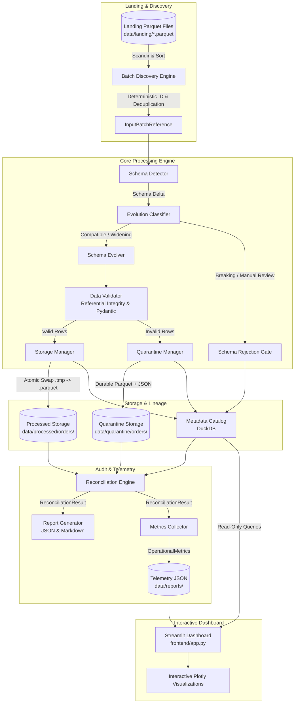

# SchemaGuard System Architecture

## 1. Executive Summary & Design Principles

**SchemaGuard** is an enterprise data engineering framework designed to resolve schema drift, data quality decay, and reconciliation opacity across distributed Parquet ingestion pipelines.

### Core Architectural Principles
1. **Contract-First Orchestration:** All pipeline stages communicate via strongly typed contracts (`InputBatchReference`, `OutputArtifactReference`, `BatchExecutionResult`, `PipelineExecutionResult`, `ReconciliationResult`, `OperationalMetrics`).
2. **Deterministic Record Conservation:** Absolute mathematical accounting is enforced across all operational states:
   $$\mathbf{I = V + Q + U}$$
   Where Input ($I$) strictly equals Valid Persisted ($V$) + Quarantined ($Q$) + Unaccounted/Rejected ($U$).
3. **Atomic Storage Publication:** Processed datasets are staged in transient files (`.tmp`) and published atomically using `os.replace` to prevent partial writes during runtime interruptions.
4. **Non-Blocking Fault Containment:** Breaking schema shifts or corrupted files are isolated at the individual batch boundary, allowing healthy batches to proceed without aborting the pipeline.
5. **Durable Quarantine Sidecars:** Invalid records are partitioned into durable Parquet sidecars accompanied by SHA-256 fingerprint metadata for root-cause auditability.
6. **ACID Operational Lineage:** Lineage, quality counters, and schema evolutions are committed to DuckDB with transactional rollback safety.

---

## 2. High-Level System Architecture



---

## 3. Component Responsibilities

### 3.1 Schema Detection & Evolution (`src/schema/`)
- **`SchemaDetector`:** Inspects incoming Parquet file metadata, extracts schema fields, and computes structural differences against baseline definitions in `config/source_schema.yaml`.
- **`EvolutionClassifier`:** Classifies schema deltas against rules in `config/evolution_rules.yaml` into:
  - `NO_CHANGE`: Identical schemas.
  - `COMPATIBLE`: Nullable column additions or allowed metadata shifts.
  - `APPROVED_TYPE_WIDENING`: Safe, approved type promotions (e.g., `int32` $\rightarrow$ `int64`).
  - `MANUAL_REVIEW`: Unapproved widening requiring human sign-off.
  - `BREAKING`: Dropped columns, non-nullable additions without default, or incompatible type narrowing.
- **`SchemaEvolver`:** Implements approved type widenings and nullable column additions cumulatively without mutating baseline definitions.

### 3.2 Ingestion & Validation (`src/ingestion/`, `src/validation/`)
- **`BatchProcessor`:** Orchestrates the single-batch lifecycle across detection, evolution, data validation, and quarantine routing.
- **`DataValidator`:** Validates rows using Pydantic models (`OrderRecord`, `CustomerRecord`) and enforces referential integrity against the cached customer master (`data/generated/customers.parquet`).

### 3.3 Quarantine Zone (`src/quarantine/`)
- **`QuarantineManager`:** Segregates rows violating validation rules into dedicated directories (`data/quarantine/<table_name>/<batch_id>/`).
- **Cryptographic Fingerprinting:** Emits `quarantine_metadata.json` containing SHA-256 table fingerprints, violation categories, and affected column names.

### 3.4 Processed Storage & Technical Audit Injection (`src/storage/`)
- **`StorageManager`:** Injects technical audit columns (`source_file`, `run_id`, `ingested_at`) and saves valid tables to `data/processed/<table_name>/<batch_id>.parquet`.
- **Atomic Replace:** Uses temporary staging and `os.replace` to guarantee all-or-nothing durability.

### 3.5 Metadata Catalog (`src/storage/metadata_catalog.py`, `database/`)
- **`MetadataCatalog`:** Connects to DuckDB (`data/metadata/schemaguard_metadata.duckdb`) to persist ACID transaction logs:
  - `pipeline_runs`: High-level run outcomes and record totals.
  - `batch_executions`: Batch-level paths, statuses, and row counts.
  - `schema_evolutions`: History of applied schema changes.
  - `validation_metrics`: Granular violation counters.
  - `idempotency_records`: Content-addressable fingerprint registry.

### 3.6 Multi-Batch Pipeline Orchestrator (`src/transformation/`)
- **`PipelineOrchestrator`:** Discovers input Parquet files, prevents batch ID collisions, executes batches sequentially, coordinates storage and metadata cataloging, and produces strongly typed execution contracts.

### 3.7 Reconciliation Engine (`src/reconciliation/`)
- **`ReconciliationEngine`:** Validates pipeline results against physical disk state, enforces $I = V + Q + U$, detects missing output artifacts, and flags anomalies.
- **`ReportGenerator`:** Serializes reconciliation results into machine-readable JSON and human-readable Markdown.

### 3.8 Idempotency & Safe Retries (`src/orchestration/`)
- **`IdempotencyManager`:** Computes composite keys (`<table_name>:<batch_id>:<sha256>`) to detect duplicate runs and allow legitimate reprocessing when data changes (`allow_reprocessing=True`).
- **`RetryPolicy`:** Manages bounded exponential backoff with full jitter on transient I/O locks and DuckDB contention.

### 3.9 Interactive Presentation Layer (`frontend/`)
- **Streamlit Application:** Multi-page dashboard with responsive Plotly visualizations connecting directly to the DuckDB catalog in read-only mode.

---

## 4. Storage Architecture

```text
data/
├── landing/                                  # Incoming Parquet landing zone
│   └── batch_*.parquet
├── processed/                                # Target analytical storage
│   └── orders/
│       ├── batch_001.parquet                 # Validated Parquet with audit metadata
│       └── batch_002.parquet
├── quarantine/                               # Isolated violation store
│   └── orders/
│       └── batch_006/
│           ├── invalid_records.parquet       # Raw invalid row records
│           └── quarantine_metadata.json      # Fingerprint, categories, failure details
├── metadata/                                 # Operational catalog
│   └── schemaguard_metadata.duckdb           # DuckDB database
└── reports/                                  # Auditing reports & telemetry
    ├── reconciliation_report_<id>.json
    ├── reconciliation_report_<id>.md
    └── operational_metrics_<id>.json
```

---

## 5. Security & Durability Principles
- **Read-Only Analytics:** Dashboards open DuckDB with `read_only=True` to eliminate lock contention with active pipeline writers.
- **Path Sanitization:** File path resolution prevents directory traversal via `os.path.normcase` and `os.path.abspath`.
- **Zero In-Memory Drift:** Schema configurations are immutable; runtime mutations produce derived schemas without overwriting source definitions.
